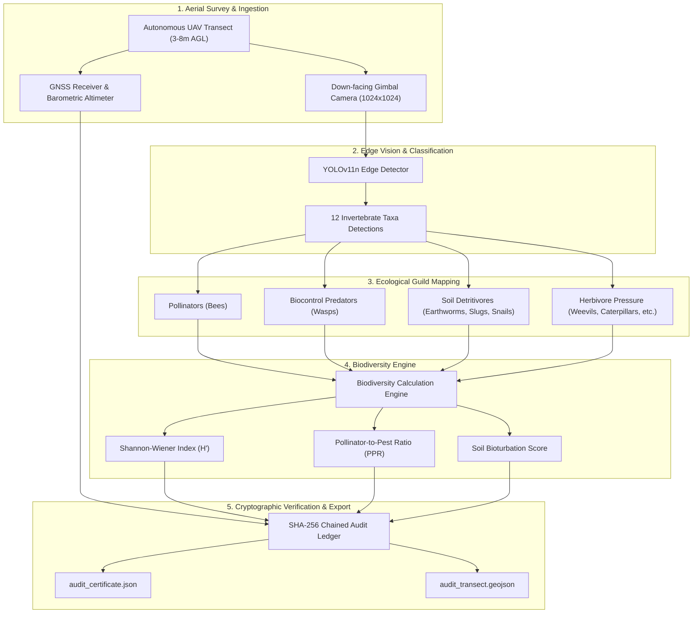

# FALCON: Autonomous Aerial Biodiversity & Nature-Credit Auditing System

FALCON is an autonomous unmanned aerial system (UAS) for verifying and auditing terrestrial biodiversity, soil faunal indicators, and ecological balance in support of biodiversity net-gain (BNG), regenerative agriculture compliance, and carbon-plus credit certification.

By deploying lightweight vision models (YOLOv11n) across aerial flight transects, FALCON classifies beneficial insects, pollinators, and herbivores simultaneously, transforming raw aerial imagery into tamper-evident biodiversity audit reports.

---

## System Architecture

---

## Project Overview & Progress

> **Completion Status:** ~50% Complete  
> **Repository:** [ashcodes28/FALCON](https://github.com/ashcodes28/FALCON)  
> **Primary Modality:** Autonomous aerial video + GNSS metadata + Edge Deep Learning

### Completed (0% - 50% Phase)
* **Baseline Vision Models:** Evaluated single-modality YOLOv8 and lightweight YOLOv11n on 1024×1024 aerial inputs, achieving 85.5% baseline classification accuracy across 12 invertebrate classes.
* **Airframe & Payload CAD:** Completed 3D structural CAD modeling for the UAV airframe, camera gimbal, and compute payload bay housing the companion edge computer.
* **Architecture & Specification:** Formulated technical specifications and patent claim outlines for autonomous terrestrial biodiversity auditing.
* **Faunal Index Engine:** Built `src/biodiversity_engine.py` to calculate the Shannon-Wiener Faunal Diversity Index, Simpson's index, Pollinator-to-Pest Ratio (PPR), and soil faunal bioturbation indicators.
* **Cryptographic Audit Ledger:** Implemented SHA-256 chained audit logs ensuring tamper-evident inspection records for credit underwriters.

### Remaining Phase (50% - 100% Phase)
* **Georeferenced Heatmapping:** Projecting local detections onto field coordinates to generate GeoJSON and raster biodiversity heatmaps.
* **Flight Controller Integration:** Connecting edge vision outputs with MAVLink telemetry for automated transect waypoint surveys.
* **Hardware Edge Optimization:** Exporting TensorRT engines for deployment on an onboard NVIDIA Jetson Orin Nano.
* **Field Trials:** Conducting transect validation on certified organic and regenerative farming parcels.

---

## Functional Ecological Guilds (12 Classes)

FALCON detects 12 biological classes, grouping them into functional ecological guilds to quantify ecosystem health:

| Ecological Guild | Detected Classes | Ecological Significance |
| :--- | :--- | :--- |
| **Pollinators** | Bees | Core indicator of floral resources and reproductive pollination service. |
| **Biocontrol Predators** | Wasps | Parasitoids and predatory regulators that naturally suppress crop damage. |
| **Soil & Detrital Fauna** | Earthworms, Slugs, Snails | Soil aeration, bioturbation, and organic decomposition indicators. |
| **Herbivore Pressure** | Caterpillars, Grasshoppers, Weevils, Beetles, Earwigs, Ants | Primary consumers and vegetation pressure points. |

---

## Core Auditing Metrics

### 1. Shannon-Wiener Faunal Diversity Index ($H'$)
Quantifies species richness and evenness across the surveyed transect:
$$H' = -\sum_{i=1}^{S} p_i \ln p_i$$
where $p_i$ is the proportion of total individuals belonging to the $i$-th detected class, and $S$ is the total number of observed classes.

### 2. Pollinator-to-Pest Ratio (PPR)
Measures the balance of beneficial regulatory services against herbivore pressures:
$$\text{PPR} = \frac{N_{\text{Bees}} + N_{\text{Wasps}}}{N_{\text{Weevils}} + N_{\text{Caterpillars}} + \epsilon}$$

### 3. Soil Bioturbation Proxy
Calculates ground-level activity rates of earthworms and detritivores along low-altitude survey waypoints to verify soil biological vitality without destructive sampling:
$$\text{Score}_{\text{soil}} = 1.5 \cdot N_{\text{Earthworms}} + 0.5 \cdot (N_{\text{Slugs}} + N_{\text{Snails}})$$

---

## Detector Baseline & Performance

Evaluation was conducted using both YOLOv8 and YOLOv11n baseline models (`best.pt`, 5.56 MB):

* **High-Precision Classes:** Snail (1.00), Weevil (1.00), Moth (0.99), Wasp (0.97), and Ants (0.87).
* **Confusion Trends:** Small boundaries cause cross-class confusion between Beetles ↔ Wasps, Caterpillars ↔ Bees/Beetles, and Slugs ↔ Earthworms.
* **Resolution:** 1024×1024 image resolution enables localization of small invertebrate targets from low-altitude hover (3–8 m).

---

## System Roadmap

- [x] Technical literature and patent landscape mapping
- [x] Dataset curation & 12-class invertebrate annotation
- [x] Baseline YOLOv8 & YOLOv11n training and validation
- [x] UAV frame, gimbal, and payload bay CAD design
- [x] Automated biodiversity index calculation engine (`src/biodiversity_engine.py`)
- [x] Cryptographic audit-trail logging with SHA-256 verification
- [x] Real-time Ecological HUD streaming (`src/detection.py`)
- [ ] MAVLink waypoint integration and dynamic transect flight planning
- [ ] Onboard companion computer deployment (Jetson Orin Nano)
- [ ] Field validation on certified regenerative agricultural plots

---

## Documentation & Assets

* [Biodiversity Auditing Specification](Biodiversity_Auditing_Specification.md)
* [Biodiversity Engine](src/biodiversity_engine.py)
* [Live Detection & Audit Script](src/detection.py)
* [Guild Isolation Lab Test](src/lab_test_detection.py)
* [Airframe CAD Visuals](CAD%20Images/)
* [License](LICENSE)
